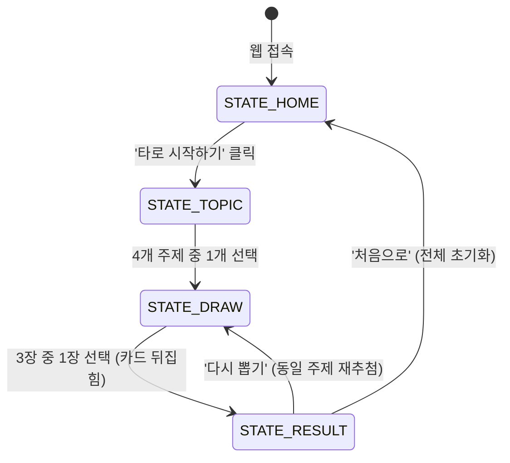

# [PRD] 오늘의 타로 (Today's Tarot) - 최소 기능 제품(MVP) 기획서

---

## 1. 서비스 개요 및 목표

- **서비스명**: 오늘의 타로 (Today's Tarot)
- **한 줄 정의**: 복잡한 절차 없이 주제를 고르고 카드를 한 장 뽑아 오늘의 운세와 마음가짐을 확인하는 가벼운 웹 타로 서비스
- **목표**:
  - 누구나 30초 이내에 직관적으로 타로 카드를 뽑고 실천적인 조언을 얻는 경험 제공
  - 외부 백엔드·데이터베이스·AI API 없이 프론트엔드 단독(Pure HTML/CSS/JS)으로 1~2일 내 구현 및 즉시 배포 가능한 경량 구조 확립
  - 모바일 터치 및 데스크톱 키보드 조작 모두를 만족하는 웹 접근성 확보

---

## 2. 기본 전제 및 합리적 가정 (Assumptions)

1. **단일 페이지 애플리케이션(SPA)**: 페이지 이동(Reload) 없이 하나의 HTML 문서 내에서 JavaScript 상태(`appState`)에 따라 4개 화면 영역을 숨김/노출(Show/Hide) 처리합니다.
2. **세션 비저장**: 브라우저를 새로고침하면 처음 화면(인트로)으로 리셋됩니다.
3. **이미지 독립성 (Fallback)**: 카드 이미지 파일이 없거나 로드 실패 시, CSS로 구현된 골드 프레임 박스와 유니코드 심볼(예: 🃏, ☀️), 카드 이름 텍스트로 자연스럽게 대체 표시됩니다.
4. **결과의 정적 콘텐츠화**: 운세 결과는 미리 작성된 로컬 JSON 텍스트를 불러오며, 사용자에게 "AI 분석" 같은 허위 표기를 일절 사용하지 않습니다.

---

## 3. MVP 포함 기능 및 제외 기능

### 3.1. MVP 포함 기능
- **4단계 화면 상태 전환**: 홈(Intro) → 주제 선택(Topic) → 카드 추첨(Draw) → 결과 확인(Result)
- **4가지 고민 주제 선택**: 오늘의 운세, 연애, 일과 커리어, 금전
- **중복 없는 3장 무작위 배정**: 메이저 아르카나 22장 중 무작위 3장을 선별해 뒷면으로 표시
- **카드 1회 선택 및 뒤집기 애니메이션**: 3장 중 1장을 선택하면 즉시 다른 카드 비활성화 후 3D 플립 효과
- **주제별 맞춤 결과 렌더링**: 카드 이름, 대표 키워드, 선택 주제에 맞는 해석, 오늘의 실천 조언 표시
- **재시도 플로우**: '같은 주제로 다시 뽑기'(새로운 3장 추첨) 및 '처음으로'(초기화) 제공
- **키보드 및 스크린리더 접근성**: Tab, Enter/Space 키로 카드 및 버튼 선택 가능
- **면책 안내 문구**: 결과 하단에 고정 문구 상시 노출

### 3.2. MVP 제외 기능
- 회원가입, 로그인, 마이페이지, 소셜 계정 연동
- 데이터베이스(DB) 및 서버 API 통신
- 결제 시스템 및 인앱 결제/광고
- 관리자(CMS) 대시보드
- 외부 생성형 AI API (OpenAI, Gemini 등) 연동
- 마이너 아르카나(56장) 및 역방향(Reversed) 해석 (정방향 22장 메이저만 사용)
- SNS 공유 링크 생성 및 이미지 캡처 다운로드 기능

---

## 4. 사용자 흐름 (User Flow & Screen States)

전체 서비스는 4개의 화면 상태(`state`)를 순차적으로 오갑니다.



---

## 5. 화면별 구성과 버튼 동작

### 5.1. [화면 1] 홈 화면 (`STATE_HOME`)
- **목적**: 서비스 첫인상 전달 및 진입 유도
- **화면 구성**:
  - 서비스 로고 및 타이틀: `오늘의 타로`
  - 서브 카피: `마음속 질문을 품고, 오늘의 카드를 확인해보세요.`
  - 신비로운 비주얼 요소: 달/별 유니코드 심볼 (✨ 🌙 🔮)
  - CTA 버튼: `[타로 시작하기]`
- **버튼 동작**:
  - `[타로 시작하기]` 클릭/터치/Enter 시 → `STATE_TOPIC`으로 전환

### 5.2. [화면 2] 주제 선택 화면 (`STATE_TOPIC`)
- **목적**: 사용자가 해석을 원하는 고민 영역 선택
- **화면 구성**:
  - 질문 타이틀: `어떤 이야기가 궁금하신가요?`
  - 4개 선택 버튼 그리드 (모바일 1열 또는 2x2):
    1. 🌟 **오늘의 운세** (전반적인 하루의 기운과 흐름)
    2. ❤️ **연애** (상대방과의 관계, 만남, 마음의 방향)
    3. 💼 **일과 커리어** (학업, 업무, 이직, 프로젝트)
    4. 💰 **금전** (소비, 투자, 재정적 결정)
- **버튼 동작**:
  - 각 주제 버튼 선택 시:
    - 선택된 `topicId`(`today` | `love` | `career` | `money`)를 메모리에 저장
    - 22장 중 서로 다른 3장의 카드를 무작위 추출하여 배치 준비
    - `STATE_DRAW`로 전환

### 5.3. [화면 3] 카드 추첨 화면 (`STATE_DRAW`)
- **목적**: 사용자가 직관에 따라 카드 1장 선택
- **화면 구성**:
  - 상단 안내 문구: `[선택한 주제] 마음을 가다듬고 한 장을 골라주세요`
  - 중앙 영역: 뒷면으로 놓인 3장의 카드 (수평 나열 또는 모바일 가로 스크롤/중앙 집중)
    - 카드 뒷면: 딥 퍼플 바탕에 골드 기하학 문양 및 테두리
  - 하단 도움말: `터치하거나 키보드(Tab / Enter)로 선택할 수 있습니다.`
- **동작 및 인터랙션**:
  - **호버/포커스**: 살짝 위로 8px 들리고 골드 글로우(Shadow) 효과
  - **카드 선택 (클릭 또는 Enter/Space)**:
    1. 클릭 즉시 3장 카드 전체에 `pointer-events: none` 적용 (다중 클릭 차단)
    2. 선택되지 않은 나머지 2장은 투명도(opacity: 0.3) 저하
    3. 선택된 카드가 Y축 180도 회전(Flip 애니메이션, 약 0.6초)하며 앞면 노출
    4. 회전 완료 후 0.4초 딜레이 뒤 `STATE_RESULT` 화면으로 부드럽게 페이드인 전환

### 5.4. [화면 4] 결과 화면 (`STATE_RESULT`)
- **목적**: 뽑은 카드의 해석과 실천 가능한 조언 전달
- **화면 구성**:
  - 선택한 카드 비주얼: 카드 앞면 (이미지 또는 골드 심볼 프레임)
  - 카드 식별 정보: 번호와 이름 (예: `No.0 바보 (The Fool)`)
  - 핵심 키워드 뱃지: `#새로운시작 #순수 #자유`
  - 결과 섹션 1: `[선택 주제]에 대한 해석` (선택된 주제에 해당하는 텍스트 본문)
  - 결과 섹션 2: `💡 오늘의 조언` (구체적 행동 지침 한 줄)
  - 하단 고정 안내문: `※ 본 서비스의 결과는 재미와 자기 성찰을 위한 콘텐츠입니다.`
  - 액션 버튼 2종:
    - `[같은 주제로 다시 뽑기]`: 현재 주제 유지, 새로운 3장 무작위 셔플 후 `STATE_DRAW`로 이동
    - `[처음으로]`: 모든 상태 초기화 후 `STATE_HOME`으로 이동

---

## 6. 기능 요구사항 표

| 기능명 | 동작 설명 | 예외 및 에지 케이스 처리 | 완료 기준 (Definition of Done) |
| :--- | :--- | :--- | :--- |
| **단일 페이지 상태 관리** | URL 변경 없이 JS 변수(`appState`)에 따라 4개 화면의 `.hidden` 클래스를 토글 | 브라우저 '새로고침' 시 `STATE_HOME`으로 초기화 | 버튼 클릭 시 페이지 깜빡임 없이 즉각 상태가 전환되어야 함 |
| **주제 선택 및 유지** | 4개 주제 중 하나를 선택하면 `currentTopic`에 코드값 저장 | 주제를 선택하지 않고 건너뛸 수 없음 | 선택된 주제 명칭이 카드 추첨 및 결과 화면에 정확히 표시되어야 함 |
| **중복 없는 3장 추첨** | 메이저 아르카나 22장 인덱스(0~21) 중 3개를 비복원 무작위 추출하여 3개 카드 슬롯에 바인딩 | 3장 중 동일한 카드가 2번 나오는 경우 배제 (Fisher-Yates 셔플) | 슬롯 1, 2, 3의 카드 ID가 서로 중복되지 않아야 함 |
| **카드 1회 선택 잠금** | 카드 1장을 누르는 순간 인터랙션 잠금 플래그(`isSelecting = true`) 작동 | 연속 다중 클릭(더블클릭), 다른 카드 동시 탭 방지 | 1회 탭 이후 다른 카드나 동일 카드를 재클릭해도 이벤트가 발생하지 않아야 함 |
| **카드 뒤집기 애니메이션** | CSS 3D Transform(`rotateY(180deg)`)을 사용하여 0.6초간 부드럽게 앞면 전환 | 3D transform 미지원 구형 브라우저에서도 앞면이 정상 노출되도록 fallback 보장 | 회전 도중 텍스트나 이미지가 반전되어 보이지 않고 정확한 앞면이 나타나야 함 |
| **이미지 Fallback 처리** | 카드 이미지 파일이 없거나 경로 에러(`onerror`) 발생 시 CSS 심볼 플레이트로 대체 | 이미지 엑스박스(깨진 아이콘)가 화면에 노출되지 않아야 함 | `assets/images/`에 파일이 없어도 카드 이름, 유니코드 심볼, 골드 테두리로 온전한 카드 형태가 렌더링됨 |
| **키보드 접근성** | 키보드 `Tab` 이동 시 모든 버튼과 3장의 카드가 포커스 링을 표시하며, `Enter` 또는 `Space`로 실행 | 키보드 연속 입력 시 중복 추첨 방지 | 마우스 없이 오직 키보드만으로 홈부터 결과 확인, 다시 뽑기까지 완료 가능 |
| **다시 뽑기 동작** | 현재 선택된 주제를 유지한 채 카드 덱에서 다시 새로운 3장을 뽑아 추첨 화면으로 이동 | 이전 결과 카드 데이터와 상태가 깔끔하게 초기화되어야 함 | 카드 뒷면 상태로 돌아가며 새로운 3장이 대기해야 함 |

---

## 7. 카드 데이터 구조와 JSON 스펙

카드 데이터는 외부 통신 없이 로컬 `cards.json` 파일로 관리되며, 메이저 아르카나 총 22장으로 구성됩니다.

### 7.1. 데이터 스키마 정의
- `id` (Number): 0 ~ 21 고유 식별자
- `name` (String): 한글 카드명 및 영문명
- `symbol` (String): 이미지 누락 시 대체 표기할 유니코드 기호
- `image` (String): 이미지 파일 상대 경로
- `keywords` (Array of Strings): 핵심 키워드 3개
- `interpretations` (Object): 4대 주제별 정방향 해석 텍스트
  - `today` (String): 오늘의 운세 해석
  - `love` (String): 연애운 해석
  - `career` (String): 일/학업/커리어 해석
  - `money` (String): 금전운 해석
- `advice` (String): 실천적 조언 한 줄

### 7.2. JSON 예시 (0번 'The Fool' 카드)

```json
[
  {
    "id": 0,
    "name": "0. 바보 (The Fool)",
    "symbol": "🎒",
    "image": "assets/images/00_the_fool.png",
    "keywords": ["새로운 시작", "순수함", "자유로운 여정"],
    "interpretations": {
      "today": "계획에 얽매이지 않고 가벼운 마음으로 하루를 시작하기 좋은 날입니다. 예상치 못한 우연에서 기분 좋은 즐거움을 발견할 수 있습니다.",
      "love": "새로운 만남의 설렘이 찾아오거나, 기존 관계에서 솔직하고 순수한 마음으로 다가갈 때 긍정적인 전환점이 생깁니다.",
      "career": "익숙한 방식 대신 새로운 시도나 아이디어를 내보기에 적합한 시기입니다. 실패를 두려워하지 않는 과감함이 필요합니다.",
      "money": "큰 욕심을 부리기보다는 지출을 단순화하고, 새로운 부업이나 배움에 소액을 투자해보기 좋은 흐름입니다."
    },
    "advice": "지나친 계산과 걱정을 내려놓고, 첫 발걸음을 가볍게 내딛어보세요."
  }
]
```

---

## 8. 디자인 및 UI 가이드

- **색상 시스템 (Color Palette)**:
  - Background (Deep Purple): `#120E24` (기본 배경), `#1E1838` (카드 및 컨테이너 배경)
  - Primary Accent (Gold): `#D4AF37` (골드 포인트, 테두리, 주요 버튼)
  - Secondary Accent (Soft Gold): `#F3E5AB` (서브 텍스트, 하이라이트)
  - Text: `#F5F3F7` (기본 본문 텍스트), `#B8B2C8` (보조 안내 텍스트)
- **타이포그래피**:
  - 기본 폰트: 시스템 기본 sans-serif (`Pretendard`, `-apple-system`, `BlinkMacSystemFont`, `sans-serif`)
  - 카드 타이틀: 명조 계열(`serif`) 포인트로 신비로운 느낌 강조
- **반응형 뷰포트**:
  - 모바일 기준: 가로 `360px ~ 430px` 최적화
  - 데스크톱: 최대 컨테이너 폭 `480px`로 중앙 정렬하여 모바일 앱 느낌 유지
- **애니메이션 원칙**:
  - 불필요한 파티클, 3D 카메라 줌 등 무거운 효과 배제
  - 카드가 뒤집히는 0.6초 플립 효과 및 버튼 탭 시 미세한 스케일 다운(`scale(0.98)`)만 적용

---

## 9. 최소 기술 구성과 폴더 구조

복잡한 빌드 도구(Webpack, Vite 등)나 Node.js 환경 없이 브라우저에서 바로 열 수 있는 정적 웹 구성을 채택합니다.

```
todays-tarot/
├── index.html              # 단일 페이지 마크업 (4개 상태 섹션 포함)
├── css/
│   └── style.css           # 딥퍼플/골드 테마, 반응형 레이아웃, 플립 애니메이션
├── js/
│   ├── app.js              # 상태 제어, 이벤트 바인딩, DOM 렌더링
│   └── tarot-data.js       # 22장 메이저 카드 데이터 배열 (JSON 또는 JS 객체)
└── assets/
    └── images/             # 카드 앞면 이미지 (없을 경우 fallback 자동 작동)
        ├── 00_the_fool.png
        └── ...
```

> [!NOTE]
> 초보 개발자가 브라우저 보안 정책(`CORS`)으로 인해 로컬 파일(`file://`)에서 `fetch('cards.json')` 실행 시 발생할 수 있는 에러를 방지하기 위해, 데이터는 `tarot-data.js` 파일 내 `const TAROT_CARDS = [...]` 전역 객체로 두거나 VS Code Live Server 환경을 활용합니다.

---

## 10. 구현 순서 및 개발 체크리스트

### 단계별 개발 가이드
1. **1단계: 레이아웃 뼈대 구축 (`index.html`)**
   - 하나의 부모 컨테이너 안에 4개 화면(`section#state-home`, `#state-topic`, `#state-draw`, `#state-result`) 마크업
   - CSS `.hidden { display: none; }` 클래스 준비
2. **2단계: 데이터셋 준비 (`js/tarot-data.js`)**
   - 22장의 메이저 아르카나 데이터 객체 완성 (우선 3~5장으로 테스트 후 22장으로 확장)
3. **3단계: 스타일링 및 애니메이션 (`css/style.css`)**
   - 딥 퍼플과 골드 테마 적용
   - 카드 뒷면 디자인 및 3D 플립 애니메이션(`perspective`, `transform-style: preserve-3d`) 구현
4. **4단계: 상태 전환 및 인터랙션 로직 (`js/app.js`)**
   - 상태 변경 함수 `setState(newState)` 작성
   - 주제 선택 시 `currentTopic` 변수 저장 및 3장 무작위 추출 함수 구현
   - 카드 선택 이벤트 연결, 중복 클릭 방지, 카드 뒤집기 후 결과 렌더링
5. **5단계: 접근성 및 예외 처리 점검**
   - 키보드 탭 이동과 엔터키 동작 확인, 이미지 없을 때 Fallback UI 점검

### 최종 점검 체크리스트 (QA)
- [ ] 메인 화면에서 '타로 시작하기'를 누르면 부드럽게 주제 선택 화면으로 전환되는가?
- [ ] 4개 주제(오늘의 운세, 연애, 커리어, 금전) 각각 선택 시 정상적으로 카드 추첨 화면으로 넘어가는가?
- [ ] 화면에 제시된 3장의 뒷면 카드가 매번 서로 다른 카드로 무작위 배정되는가?
- [ ] 카드 1장을 누르면 즉시 나머지 카드를 누를 수 없도록 방지되는가?
- [ ] 카드가 뒤집힌 후 선택한 카드 이름, 키워드, 주제 맞춤 해석, 조언이 일치하게 나타나는가?
- [ ] 이미지 파일이 없어도 깨진 이미지 아이콘 대신 골드 프레임과 심볼이 예쁘게 나타나는가?
- [ ] '다시 뽑기'를 눌렀을 때 동일 주제로 3장이 새롭게 추첨되는가?
- [ ] '처음으로'를 눌렀을 때 모든 상태가 리셋되고 홈 화면으로 돌아가는가?
- [ ] 마우스 없이 `Tab` 키와 `Enter` 키만으로 모든 단계를 원활하게 진행할 수 있는가?
- [ ] 하단에 '재미와 자기 성찰을 위한 콘텐츠입니다' 안내 문구가 누락 없이 노출되는가?

---

## 11. 향후 확장 기능 (Next Steps)

MVP 런칭 및 사용자 반응 확인 후 검토할 수 있는 최대 3가지 확장 기능입니다.

1. **결과 카드 이미지 저장 및 공유**: `html2canvas` 또는 Web Share API를 적용하여 뽑은 카드와 오늘의 조언을 인스타그램 스토리/카카오톡으로 공유할 수 있는 이미지 생성 기능
2. **오늘의 기록 (로컬 캘린더)**: 브라우저 `localStorage`를 활용하여 하루에 한 번 뽑은 카드를 캘린더에 스탬프로 기록하고 돌아볼 수 있는 무가입 아카이빙 기능
3. **3-카드 스프레드 모드 추가**: 단일 카드 외에 '과거 - 현재 - 미래' 또는 '상황 - 문제 - 해결'을 3장 연속으로 뽑아 입체적으로 살펴보는 심화 모드
