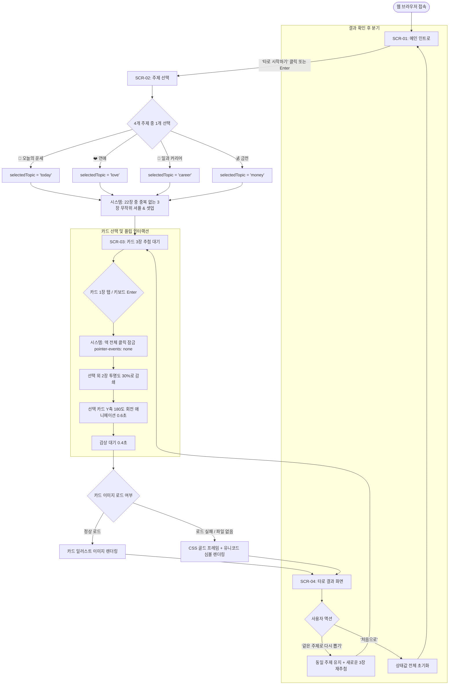

# [오늘의 타로] 유저플로우 (User Flow)

본 문서는 사용자가 '오늘의 타로' 웹서비스에 접속하여 타로 카드를 확인하고 다음 행동을 결정하기까지의 전체 여정과 분기 흐름을 정의한 설계서입니다.

---

## 1. 개요 및 상태 머신 정의

본 서비스는 단일 페이지(SPA) 구조로 동작하며, 4개의 핵심 화면 상태(`AppState.currentScreen`)를 기준으로 전환됩니다.

| 화면 코드 | 화면 명칭 | 진입 조건 | 주요 목적 |
| :--- | :--- | :--- | :--- |
| **SCR-01** | 메인 인트로 (`HOME`) | 서비스 최초 접속 또는 '처음으로' 클릭 | 서비스 소개 및 시작 유도 |
| **SCR-02** | 주제 선택 (`TOPIC`) | 인트로에서 '타로 시작하기' 클릭 | 사용자의 고민 분야(4개 중 1개) 특정 |
| **SCR-03** | 카드 추첨 (`DRAW`) | 주제 선택 완료 직후 | 뒷면 3장 중 직관에 따른 1장 선택 |
| **SCR-04** | 결과 확인 (`RESULT`) | 카드 플립 애니메이션(1.0초) 종료 | 해석/조언 확인 및 재시도/종료 결정 |

---

## 2. 전체 서비스 유저플로우 다이어그램

---

## 3. 단계별 상세 유저 행동 및 시스템 반응 시퀀스

### Step 1: 메인 인트로 진입
- **유저 행동**: 사용자가 브라우저 URL로 접속.
- **시스템 반응**:
  - DOM 생성 후 스크립트 실행.
  - `AppState`를 `{ currentScreen: 'HOME', selectedTopic: null, pickedCard: null, isSelecting: false }`로 설정.
  - `SCR-01`만 화면에 표시하고 나머지 섹션은 `.hidden` 처리.

### Step 2: 타로 시작하기
- **유저 행동**: `[타로 시작하기]` 버튼을 터치/클릭하거나 키보드 `Enter` 키 입력.
- **시스템 반응**:
  - `SCR-01`에 페이드아웃 효과 적용 후 숨김 처리.
  - `AppState.currentScreen`을 `'TOPIC'`으로 변경.
  - `SCR-02` 화면 표시 및 첫 번째 주제 버튼에 포커스 가능 상태 부여.

### Step 3: 주제 선택
- **유저 행동**: 4개 주제(오늘의 운세, 연애, 일과 커리어, 금전) 중 관심 있는 버튼 1개 선택.
- **시스템 반응**:
  - 클릭된 버튼의 `data-topic` 속성값(예: `love`)을 `AppState.selectedTopic`에 저장.
  - 전체 메이저 카드 22장에서 3장을 중복 없이 무작위 추출(Fisher-Yates 셔플).
  - 추출된 3장의 정보를 `AppState.drawnCards`에 저장하고 `SCR-03`의 카드 슬롯 3개에 바인딩.
  - `SCR-02` 숨김, `SCR-03` 표시.

### Step 4: 카드 선택 및 인터랙션
- **유저 행동**: 뒷면으로 놓인 3장의 카드 중 직관적으로 끌리는 1장을 클릭/터치하거나 `Tab`으로 포커스 후 `Enter` 입력.
- **시스템 반응**:
  1. `AppState.isSelecting === true` 여부 검사. (이미 선택 중이면 무시)
  2. `AppState.isSelecting = true`로 설정하고 덱 전체에 `pointer-events: none` 적용.
  3. 선택되지 않은 나머지 2장 카드에 `.dimmed` 클래스 부착 (투명도 0.3으로 감소).
  4. 선택된 카드에 `.is-flipped` 클래스 부착 (0.6초 동안 3D 180도 Y축 회전하며 앞면 노출).
  5. 사용자가 선택한 카드를 `AppState.pickedCard`로 확정.
  6. 애니메이션 0.6초 + 0.4초 대기 후 `SCR-04`로 화면 전환.

### Step 5: 결과 확인
- **유저 행동**: 카드 이름, 키워드, 선택된 주제에 맞는 해석, 오늘의 조언을 스크롤하며 정독.
- **시스템 반응**:
  - 카드 이미지 경로(`pickedCard.image`) 로드 시도. 로드 실패(`onerror`) 시 골드 테두리 심볼 플레이트로 즉각 대체.
  - `pickedCard.interpretations[selectedTopic]` 텍스트를 정확히 매핑하여 렌더링.
  - 결과 하단 면책 문구 노출: *"※ 본 서비스의 결과는 재미와 자기 성찰을 위한 콘텐츠입니다."*

### Step 6: 재시도 또는 종료 분기
- **옵션 A: '같은 주제로 다시 뽑기'**
  - **유저 행동**: `[같은 주제로 다시 뽑기]` 버튼 클릭.
  - **시스템 반응**:
    - `AppState.selectedTopic`은 그대로 유지.
    - 22장 풀에서 새로운 3장을 다시 무작위 추출하여 슬롯 재배치.
    - 카드의 플립 및 딤드 스타일을 원상복구(뒷면 상태).
    - `AppState.isSelecting = false`, `AppState.pickedCard = null` 리셋.
    - `SCR-03` 화면으로 복귀.
- **옵션 B: '처음으로'**
  - **유저 행동**: `[처음으로]` 버튼 클릭.
  - **시스템 반응**:
    - `AppState`의 모든 필드를 초기값으로 완전 리셋.
    - `SCR-01` 인트로 화면으로 복귀.

---

## 4. 예외 및 에지 케이스 흐름 (Exception Flows)

### 4.1 중복 클릭 (Double Tap / Multi-Touch)
- **상황**: 사용자가 카드를 빠르게 여러 번 연타하거나 2개 이상의 카드를 두 손가락으로 동시 터치.
- **처리 흐름**:
  1. 첫 번째 탭 이벤트가 발생한 순간 `AppState.isSelecting = true`가 동기적으로 설정됨.
  2. 뒤이어 들어오는 모든 탭/클릭 이벤트는 `if (AppState.isSelecting) return;` 방어 코드에 의해 차단.
  3. CSS `#card-deck { pointer-events: none; }`가 즉시 부여되어 브라우저 레벨에서도 추가 인터랙션 방지.

### 4.2 키보드 접근성 네비게이션 흐름
- **상황**: 마우스/터치 없이 키보드만 사용하는 환경.
- **처리 흐름**:
  - `Tab` 키를 누르면 다음 대화형 요소(`button`, `.card-item[tabindex="0"]`)로 순차 이동.
  - 활성화된 요소에 골드 색상의 아웃라인(`outline: 2px solid #D4AF37`) 표시.
  - `Enter` 또는 `Space` 키 입력 시 `click` 이벤트와 동일한 동작 트리거.

### 4.3 브라우저 새로고침 (F5 / Refresh)
- **상황**: 사용자가 카드 추첨 중이거나 결과 화면에서 새로고침을 누름.
- **처리 흐름**:
  - MVP는 로컬 세션 영속화를 하지 않으므로 초기 상태(`SCR-01`)로 깔끔하게 리셋.
  - 깨진 상태나 빈 화면이 노출되지 않고 인트로 화면부터 정상 시작.
