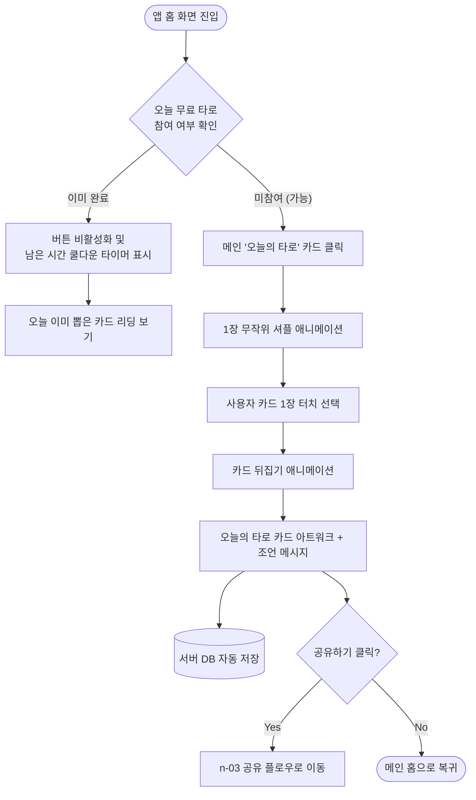
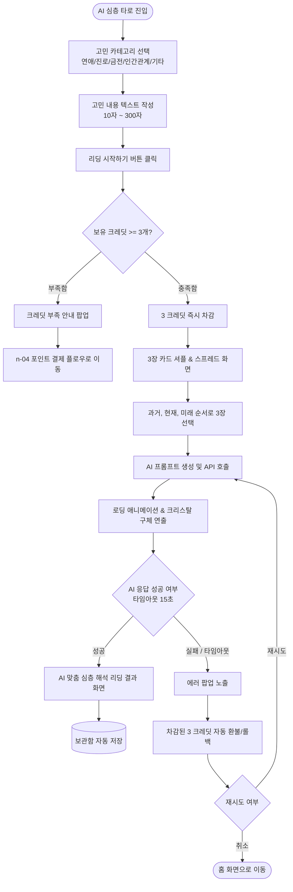
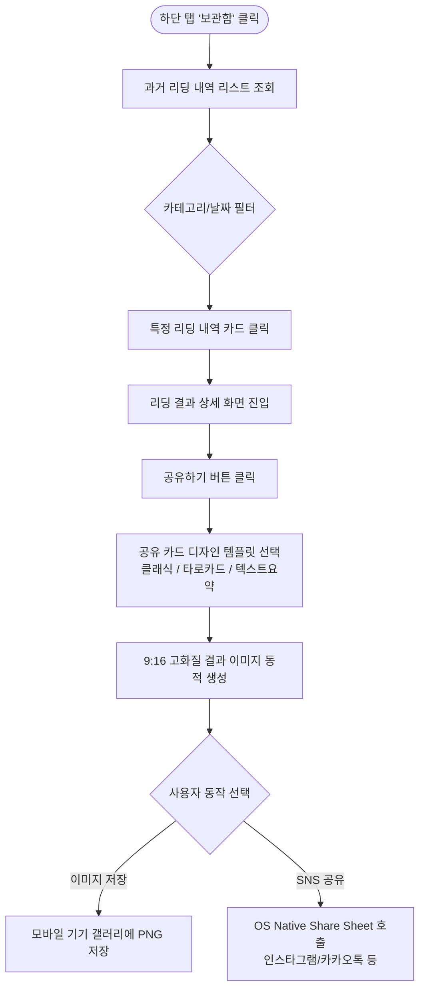
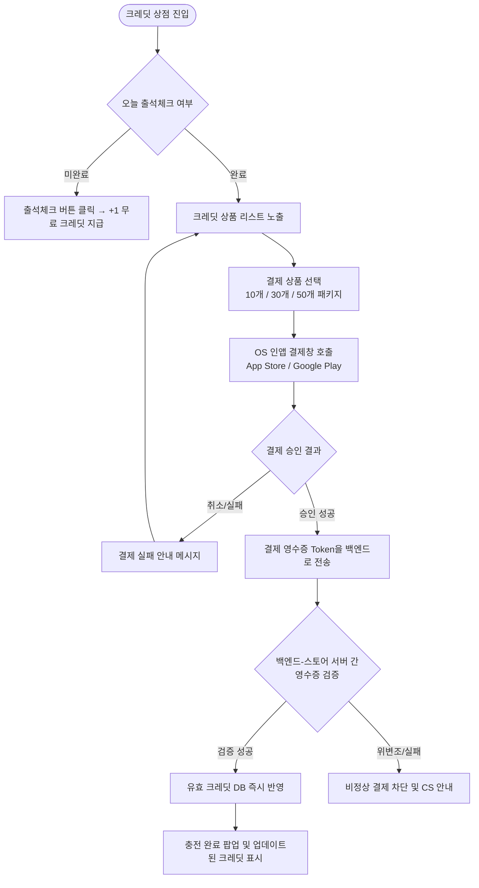

# [유저플로우] AI 타로 서비스 앱 '타로티카(Tarotica)' 사용자 흐름 정의서

- **문서 ID**: UF-TAROT-2026-03
- **작성일**: 2026-10-21
- **버전**: v1.0
- **표준 규격**: 서비스 기획 프로세스 표준 SOP (P- → F- → n- → S- 추적성 준수)
- **상위 문서**: `tarot_app_functional_spec.md` (기능명세서 F-01 ~ F-04)

---

## 1. 개요 및 추적성 매핑 (Traceability Matrix)

본 문서는 상위 기능명세서(`F-01` ~ `F-04`)에 정의된 비즈니스 로직과 예외 규정을 바탕으로, 사용자의 앱 내 이동 경로, 조건별 선택 분기, 예외 처리 프로세스를 시각적 흐름으로 정의합니다.

| 유저플로우 ID | 플로우명 | 상위 기능 ID | 연결 PRD ID | 주요 화면 및 목적 |
| :--- | :--- | :--- | :--- | :--- |
| **n-01** | 일일 무료 타로 플로우 | F-01 | P-01 | 홈 화면 진입 → 1장 선택 → 오늘의 운세 결과 확인 |
| **n-02** | AI 심층 타로 플로우 | F-02 | P-02 | 고민 작성 → 3장 스프레드 선택 → AI 생성 → 결과 리딩 |
| **n-03** | 보관함 및 결과 공유 플로우 | F-03 | P-03 | 보관함 목록 → 과거 결과 상세 → SNS 카드 공유 |
| **n-04** | 포인트 충전 및 결제 플로우 | F-04 | P-04 | 재화 부족 알림/상점 → 상품 선택 → 인앱 결제 → 크레딧 지급 |

---

## 2. 핵심 유저플로우 상세 (n-01 ~ n-04)

### 2.1 [n-01] 일일 무료 타로 플로우 (Daily Free Tarot)

#### 세부 단계별 프로세스 (Step-by-Step)
1. **[진입]** 사용자가 앱 홈 화면에 진입합니다.
2. **[상태 검증]** 서버가 유저의 자정(`00:00:00 KST`) 기준 `daily_tarot_drawn` 상태를 확인합니다.
   - **미참여 상태**: '오늘의 카드 뽑기' 활성화 버튼 노출.
   - **완료 상태**: 버튼 비활성화 및 다음 자정까지 남은 쿨다운 타이머 노출.
3. **[카드 선택]** 사용자가 셔플된 카드 더미 중 1장을 터치합니다.
4. **[결과 연출]** 카드 뒤집기 3D 애니메이션 연출 후, 당일의 운세 및 3줄 조언 메시지가 노출됩니다.
5. **[저장 및 종료]** 결과는 DB에 자동 기록되며, 공유 또는 홈 복귀를 선택할 수 있습니다.

---

### 2.2 [n-02] AI 심층 타로 플로우 (Deep AI Tarot)

#### 세부 단계별 프로세스 (Step-by-Step)
1. **[질문 입력]** 카테고리 선택 후 고민 내용을 작성합니다 (최소 10자 미만 시 [시작] 버튼 비활성화).
2. **[크레딧 검증 및 차감]** 
   - 크레딧 부족 시 `n-04` 결제 플로우로 유도합니다.
   - 크레딧 충족 시 선차감 처리 후 카드 선택 화면으로 이동합니다.
3. **[3장 카드 선택]** 과거, 현재, 미래 각 위치에 맞추어 카드 3장을 차례로 터치합니다.
4. **[AI 리딩 생성]** 로딩 화면(크리스탈 구체 애니메이션) 동안 AI API가 호출됩니다.
5. **[예외 처리]** 15초 초과 또는 API 에러 발생 시 크레딧을 즉시 자동 롤백하고 안내 메시지를 출력합니다.
6. **[결과 확인]** 종합 요약, 카드리딩 세부 풀이, 행운의 액션이 포함된 결과를 표시합니다.

---

### 2.3 [n-03] 보관함 및 결과 공유 플로우 (Archive & Share)

#### 세부 단계별 프로세스 (Step-by-Step)
1. **[보관함 진입]** 과거 진행했던 일일 타로 및 AI 심층 타로 리딩 내역이 최신순으로 정렬됩니다.
2. **[상세 보기]** 내역 항목을 클릭하면 당시 뽑은 카드 아트워크와 AI 해석 전문을 다시 확인할 수 있습니다.
3. **[공유 카드 생성]** [공유하기] 클릭 시 9:16 비율의 아름다운 카드 형태로 이미지가 동적으로 합성됩니다.
4. **[공유 실행]** 이미지 저장 또는 카카오톡/인스타그램 스토리 등으로 직접 공유합니다.

---

### 2.4 [n-04] 포인트 충전 및 결제 플로우 (Point & IAP)

#### 세부 단계별 프로세스 (Step-by-Step)
1. **[상점 진입]** 상단 재화 영역 클릭 또는 심층 리딩 크레딧 부족 시 이동합니다.
2. **[무료 보상]** 일일 출석 체크 시 즉시 무료 크레딧 1개가 지급됩니다.
3. **[상품 결제]** 구매할 크레딧 패키지 선택 시 OS 표준 인앱 결제 모달이 실행됩니다.
4. **[영수증 검증]** 결제 완료 후 서버 대 서버 영수증 검증을 거쳐 안전하게 크레딧을 반영합니다.

---

## 3. 예외 및 분기 처리 종합 매트릭스

| 예외 상황 | 해당 플로우 | 감지 시점 | 시스템 분기 및 처리 내용 |
| :--- | :--- | :--- | :--- |
| **자정 경계 시간 진입** | n-01 | 카드 선택 시점 | `00:00:00` 경과 시 이전 세션 자동 종료 후 메인 홈으로 리다이렉트 |
| **AI 생성 중 앱 종료/이탈** | n-02 | API 응답 수신 전 | 백그라운드 처리 후 결과는 보관함에 자동 저장, 재진입 시 푸시 알림 제공 |
| **네트워크 연결 끊김** | All | 모든 API 호출 시 | 인터넷 연결 상태 확인 toast 메시지 노출 및 재시도 버튼 제공 |
| **이중 결제 발생** | n-04 | 영수증 검증 시점 | 동일 Transaction ID 재요청 시 기존 검증 결과 재활용(이중 지급 방지) |

---

## 4. 문서 추적성 및 다음 단계
- 본 유저플로우의 `n-01` ~ `n-04` 흐름은 하위 문서인 **와이어프레임 설계서(`S-01` ~ `S-04`)**의 화면 전환 및 컴포넌트 구조의 기준이 됩니다.
